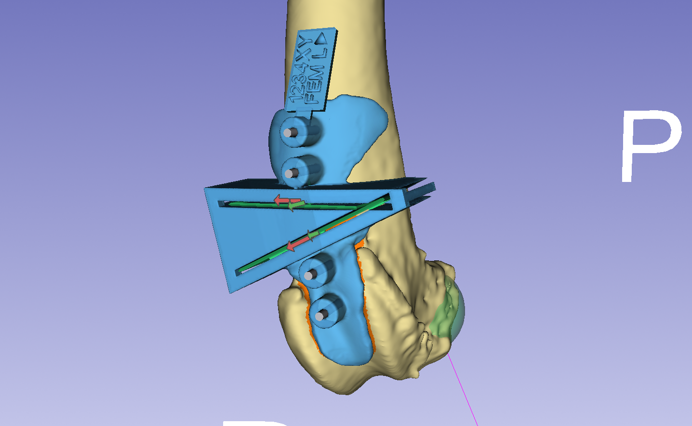
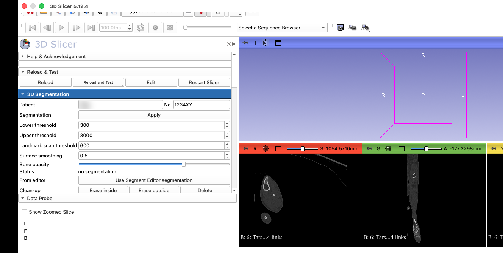
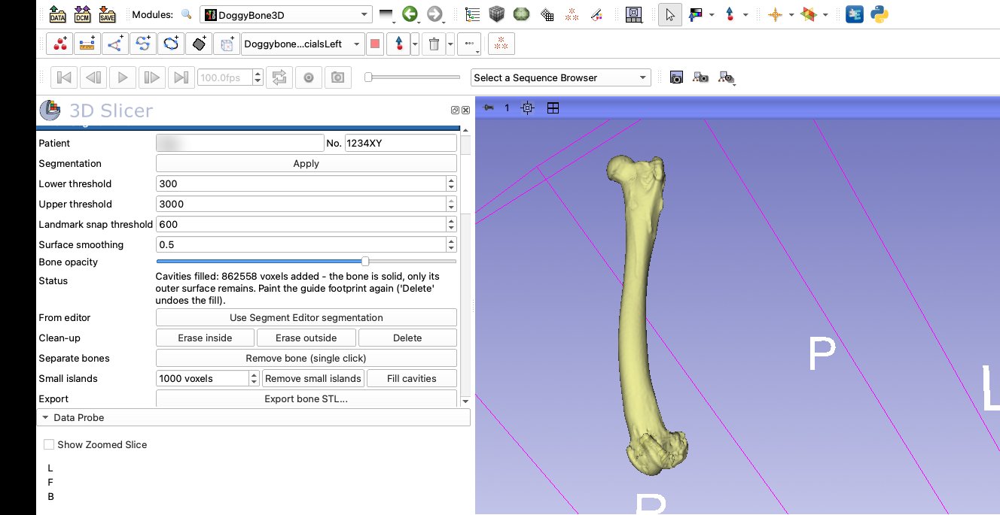
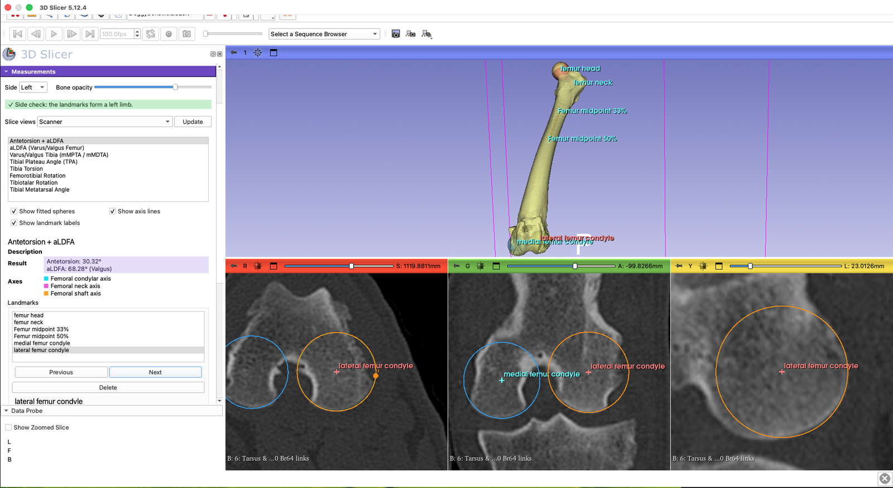
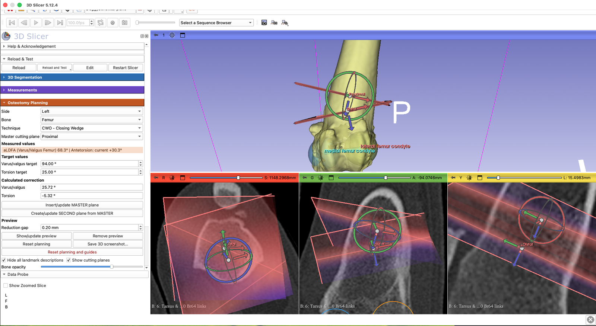
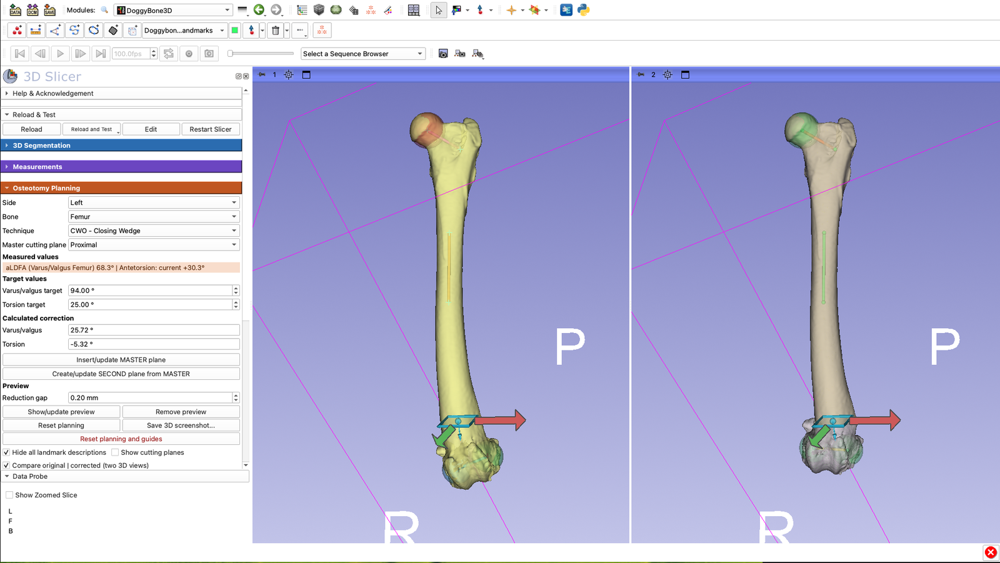
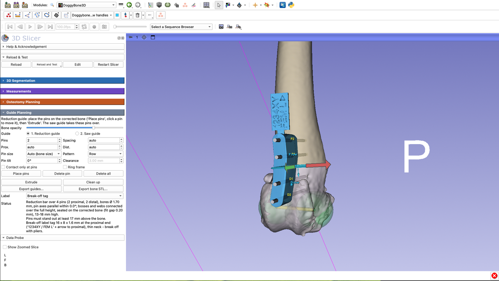
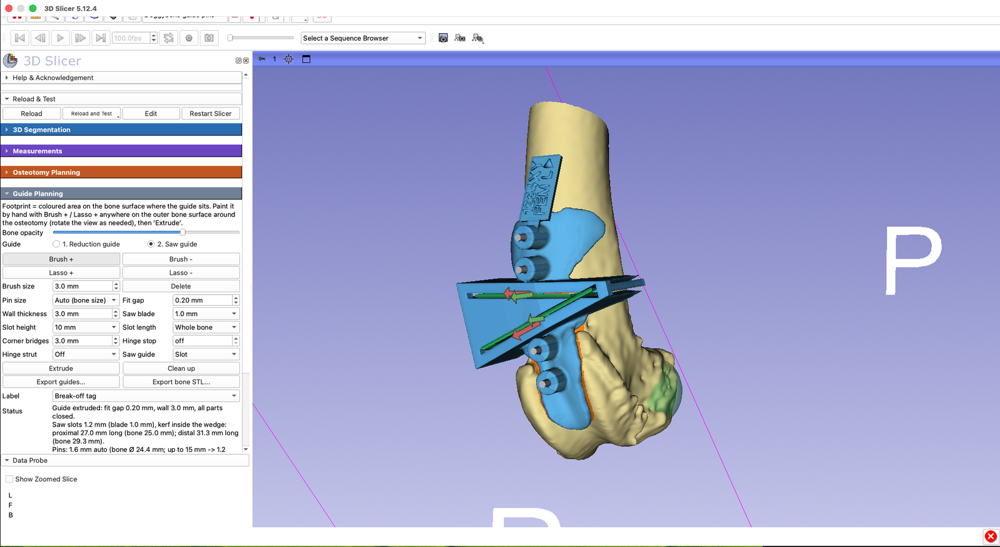
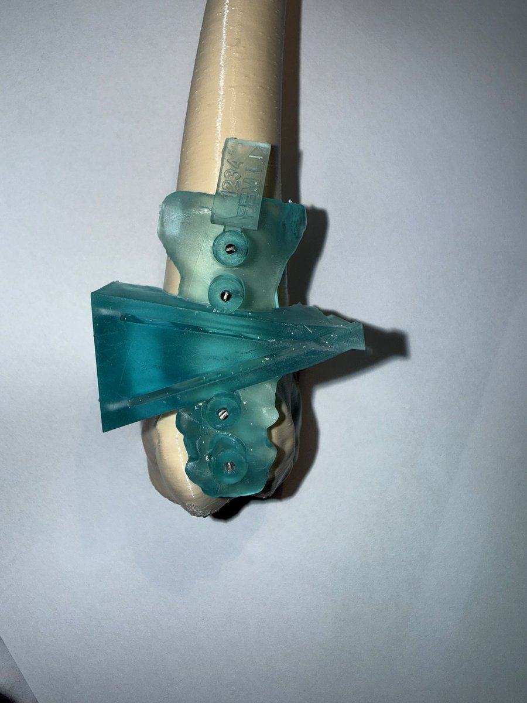

# DoggyBone3D

**DoggyBone3D** is a 3D Slicer module for the canine hind limb. It contains the canine hind-limb
angle measurements of BoneAngleMeter and extends them with

- corrective osteotomy planning: closing / opening wedge, bisecting principle, contact-congruent
  alignment (hinge closure and derotation about the contact-face normal), in-plane fine shift with
  a gizmo, prediction of the postoperative angles,
- patient-specific cutting-guide design: footprint on the bone surface (suggestion, brush and
  lasso), extrusion into the guide body with fit gap and wall thickness,
- segmentation clean-up in 3D (lasso, removal of small islands).

In Slicer it appears under **Orthopedics > DoggyBone3D**.

> **For research use only.** DoggyBone3D is not a certified medical device. All measurements and
> planning results must be verified by the surgeon.

**Author:** Matthias Frank, Kleintierklinik Frank & Partner, Freiburg, Germany

**Based on** [BoneAngleMeter](https://github.com/jburgp/BoneAngleMeter_public) by Juliette Burg
Personnaz and Andreas Voigt, developed during Juliette Burg Personnaz' doctorate at CTK, LMU Munich.

**Acknowledgement:** The interactive, rotatable cutting planes follow the approach of
[Osteotomy Planner](https://github.com/KitwareMedical/OsteotomyPlanner) (Sam Horvath, Ye Han, Beatriz Paniagua,
Kitware), a 3D Slicer extension for human craniofacial surgery planning.

**License:** MIT (see [LICENSE](LICENSE)) - Copyright (c) 2022 Juliette Burg Personnaz, Andreas
Voigt; Copyright (c) 2026 Matthias Frank, Kleintierklinik Frank & Partner.

## Requirements

- [3D Slicer](https://download.slicer.org/) 5.x (developed and tested with 5.12)
- A CT scan of the canine hind limb (DICOM or any volume format Slicer reads)

## Installation

1. Install [3D Slicer](https://download.slicer.org/).
2. Download this repository (green **Code** button > **Download ZIP**, or the `.zip` of the latest release) and unpack it, e.g. to `Documents`.
3. In Slicer open **Modules > Developer Tools > Extension Wizard** and click **Select Extension**.
4. Choose the unpacked folder and confirm.
5. DoggyBone3D now appears under **Modules > Orthopedics > DoggyBone3D**.

Alternatively add the module folder directly: **Edit > Application Settings > Modules > Additional module
paths > Add**, choose the `Doggybone` folder inside the unpacked repository and restart Slicer.

## Workflow

The module panel is organised in four sections, used from top to bottom. The pictures show a left
femur with a distal closing-wedge osteotomy.

### 1. Load the CT and enter the patient

Load the CT of the hind limb (DICOM or any volume format Slicer reads) and open **DoggyBone3D**.
Patient name and number are used for the names of the exported files; the number is also printed on the label tag of the guides.

### 2. 3D Segmentation

Threshold the bone from the CT with **Apply**, then clean the segmentation up in 3D: erase inside /
outside a lasso, remove a neighbouring bone with a single click, remove small islands and fill
cavities. **Export bone STL** saves the bone model for printing.

### 3. Measurements

Choose the side and a measurement, then place the landmarks; each landmark comes with a description
and a picture. Angles (aLDFA, antetorsion, tibial varus/valgus mMPTA / mMDTA, TPA, tibial torsion,
...) and their axes are shown live. A side check confirms that the landmarks form a left or a right
limb.

### 4. Osteotomy Planning: cutting planes

Choose bone and technique (opening or closing wedge) and the master cutting plane. The measured
values are read from the landmarks; enter the target values and the module calculates the
correction. **Insert/update MASTER plane** places the first cutting plane, **Create/update SECOND
plane from MASTER** derives the second one. Both planes can be moved and rotated with their handles.

### 5. Osteotomy Planning: correction preview

**Show/update correction preview** cuts the bone, closes or opens the wedge and shows the corrected
bone together with the predicted postoperative angles. *Compare original | corrected* shows the
original bone (left) and the corrected bone (right) in two linked 3D views.

### 6. Guide Planning: reduction guide

Place the pins on the corrected bone and **Extrude** the reduction guide. It holds the fragments in
the planned position after the cut; the saw guide takes over the same pins. The label tag with
patient number, bone and side can be broken off after use.

### 7. Guide Planning: saw guide

Paint the footprint on the bone surface (brush / lasso), set fit gap, wall thickness and saw blade,
and **Extrude** the saw guide with its slots. **Export guides** saves all finished guides, one STL
per guide, named by patient, bone, side and type. The export warns if a guide is outdated because
the plan changed after it was built.

### 8. Print

The printed saw guide on a printed bone model:

## Tests

In Slicer, enable **Edit > Application Settings > Developer > Enable developer mode**; the module then
shows **Reload and Test**, which runs the self-test (`DoggyboneTest` in `Doggybone/Doggybone.py`) on
synthetic data. The geometry regression tests in `Doggybone/Testing/Python` can also be run on their
own: `PythonSlicer -m unittest Doggybone/Testing/Python/test_doggybone_geometry.py`.
