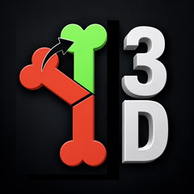

# DoggyBone3D

**DoggyBone3D** is a 3D Slicer module for the canine hind limb. It contains the canine hind-limb
angle measurements of BoneAngleMeter and extends them with

- corrective osteotomy planning: closing / opening wedge, bisecting principle, contact-congruent
  alignment (hinge closure and derotation about the contact-face normal), in-plane fine shift with
  a gizmo, prediction of the postoperative angles,
- patient-specific cutting-guide design: footprint on the bone surface (suggestion, brush and
  lasso), extrusion into the guide body with fit gap and wall thickness,
- segmentation clean-up in 3D (lasso, removal of small islands).

In Slicer it appears under **Orthopedics > DoggyBone3D**.

> **For research use only.** DoggyBone3D is not a certified medical device. All measurements and
> planning results must be verified by the surgeon.

**Author:** Matthias Frank, Kleintierklinik Frank & Partner, Freiburg, Germany

**Based on** [BoneAngleMeter](https://github.com/jburgp/BoneAngleMeter_public) by Juliette Burg
Personnaz and Andreas Voigt, developed during Juliette Burg Personnaz' doctorate at CTK, LMU Munich.

**Acknowledgement:** The interactive, rotatable cutting planes follow the approach of
[Osteotomy Planner](https://github.com/KitwareMedical/OsteotomyPlanner) (Sam Horvath, Ye Han, Beatriz Paniagua,
Kitware), a 3D Slicer extension for human craniofacial surgery planning.

**License:** MIT (see [LICENSE](LICENSE)) - Copyright (c) 2022 Juliette Burg Personnaz, Andreas
Voigt; Copyright (c) 2026 Matthias Frank, Kleintierklinik Frank & Partner.

## Requirements

- [3D Slicer](https://download.slicer.org/) 5.x (developed and tested with 5.12)
- A CT scan of the canine hind limb (DICOM or any volume format Slicer reads)

## Installation

1. Install [3D Slicer](https://download.slicer.org/).
2. Download this repository (green **Code** button > **Download ZIP**, or the `.zip` of the latest release) and unpack it, e.g. to `Documents`.
3. In Slicer open **Modules > Developer Tools > Extension Wizard** and click **Select Extension**.
4. Choose the unpacked folder and confirm.
5. DoggyBone3D now appears under **Modules > Orthopedics > DoggyBone3D**.

Alternatively add the module folder directly: **Edit > Application Settings > Modules > Additional module
paths > Add**, choose the `Doggybone` folder inside the unpacked repository and restart Slicer.

## Workflow

The module panel is organised in four sections, used from top to bottom:

1. **3D Segmentation** - threshold the bone from the CT, clean the segmentation up in 3D.
2. **Measurements** - place the landmarks for the left or right limb; the angles (aLDFA, antetorsion,
   tibial varus/valgus, TPA, tibial torsion, ...) and their axes are shown live.
3. **Osteotomy Planning** - choose bone and technique, insert the cutting planes, set the target
   values and let the module suggest the correction; the corrected bone and the predicted
   postoperative angles are shown.
4. **Guide Planning** - paint the guide footprint on the bone, extrude the osteotomy guide and the
   reduction guide with pins / saw slots, and save all finished guides with **Export guides**
   (one STL per guide, named by patient, bone, side and type). The export warns if a guide is
   outdated because the plan changed after it was built.

## Tests

In Slicer, enable **Edit > Application Settings > Developer > Enable developer mode**; the module then
shows **Reload and Test**, which runs the self-test (`DoggyboneTest` in `Doggybone/Doggybone.py`) on
synthetic data. The geometry regression tests in `Doggybone/Testing/Python` can also be run on their
own: `PythonSlicer -m unittest Doggybone/Testing/Python/test_doggybone_geometry.py`.
